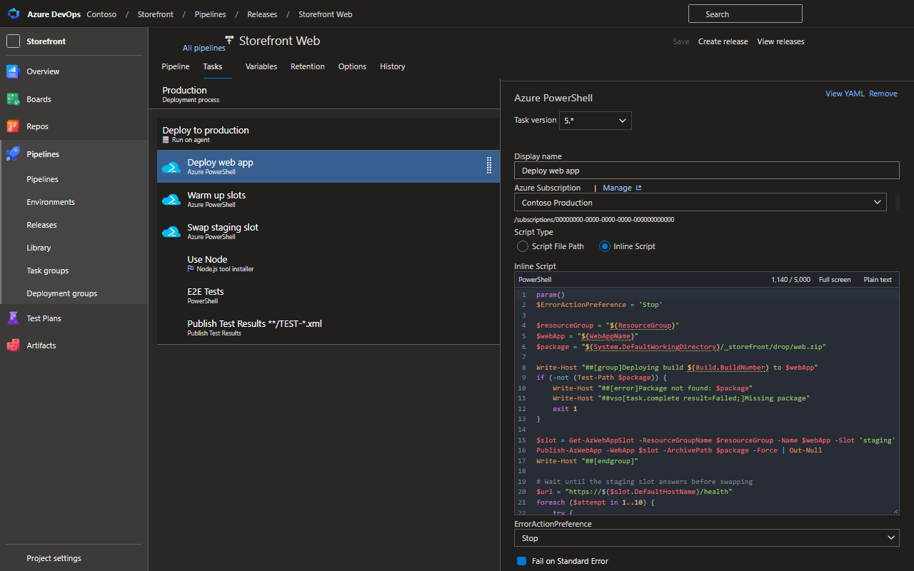

# Script Editor for Azure DevOps

A browser extension for Chrome and Edge that turns the plain text box for inline scripts in Azure DevOps pipeline tasks into a real code editor.



## Features

- **Syntax highlighting** for PowerShell, Bash and Python, picked automatically from the task type (Azure PowerShell, PowerShell, Bash, Command line, Python, and Azure CLI according to its Script Type).
- **Autocomplete** for keywords, common cmdlets and commands, the words already in your script, and snippets for logging commands (`##vso[task.setvariable]`, `##[group]`, `##[error]`…).
- **Pipeline variables** such as `$(Build.BuildId)` stand out from the rest of the code.
- **Full screen** for long scripts (Esc to exit), and a **Plain text** button that brings back the original text box.
- **Character counter** that warns before you go over the field's limit (5,000 characters on most tasks).
- Line numbers, code folding, bracket matching, search and replace (Ctrl+F), multiple cursors, Tab to indent.
- Settings in the toolbar popup: theme (matches Azure DevOps by default), font size and line wrapping.

It works in classic release and build pipelines and task groups. YAML pipelines already have their own editor, so the extension doesn't change them.

## Install

- Chrome Web Store: _link after publishing_
- Microsoft Edge Add-ons: _link after publishing_
- Manual: download the zip from [Releases](https://github.com/maxijabase/ado-script-editor/releases), unzip it and load the folder with **Load unpacked** (see below).

## Privacy

The extension makes no network requests and collects no data. See [PRIVACY.md](PRIVACY.md).

## Development

Requires Node 22+ and pnpm.

```bash
pnpm install
pnpm build    # builds the unpacked extension into dist/
pnpm watch    # rebuilds content.js on change
pnpm zip      # builds and packs script-editor-for-azure-devops-<version>.zip for the stores
```

Load `dist/` with **Load unpacked** on `chrome://extensions` or `edge://extensions` (Developer mode on), then reload the extension after each build.

`test.html` is a small mock of the Azure DevOps task form for trying changes without a real pipeline. Serve the folder (for example with `python -m http.server`) and open it.

### Releasing

Bump `version` in `manifest.json` (and `package.json`), commit, then push a matching tag:

```bash
git tag v1.0.1
git push origin v1.0.1
```

The Release workflow checks the tag against the manifest, builds the zip and attaches it to a new GitHub release.

### How it works

A content script watches the page for textareas labelled "Script" or "Inline Script", hides them and mounts a [CodeMirror 6](https://codemirror.net/) editor in their place. Edits are written back through the textarea's native value setter followed by an `input` event, so Azure DevOps' React form picks them up and enables Save. Because Azure DevOps reuses the same textarea when you switch between tasks, the editor checks it every 300 ms and reloads its text and language when they change.

## License

[MIT](LICENSE). Not affiliated with or endorsed by Microsoft. Azure DevOps is a trademark of Microsoft Corporation.
